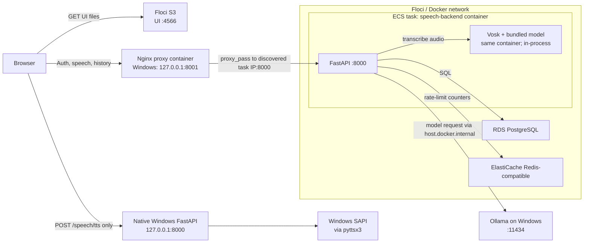
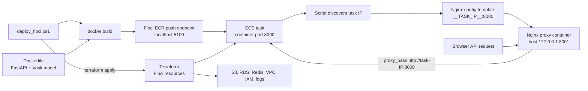
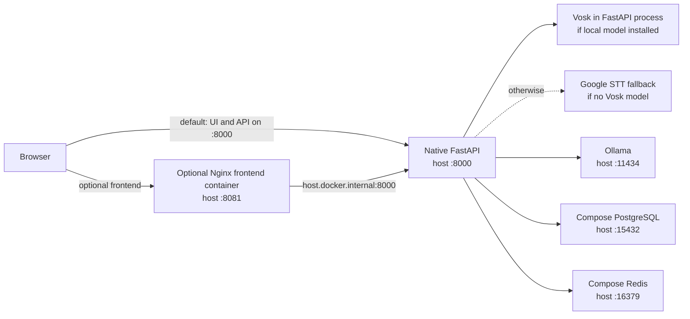

# Speech-to-Speech Voice Assistant

FastAPI, Vosk, Ollama, PostgreSQL, and Redis, with a browser UI and an optional Floci deployment. This guide focuses on where each component runs and how requests move between them.

## Floci: runtime and request routing



**Ports are different sides of different processes:** the ECS container listens on `8000` inside Docker; the host does not publish that port. The proxy container publishes host port `8001` on loopback and forwards requests to the ECS task's discovered Docker IP. Separately, the native Windows FastAPI process listens on host port `8000` for browser TTS.

The UI is at `http://localhost:4566/speech-frontend/index.html`. Its conversation API requests use `http://127.0.0.1:8001`; its TTS request uses `http://127.0.0.1:8000` so audio is spoken with Windows SAPI. Keep the native FastAPI process running for this TTS route. Its normal startup also requires its configured PostgreSQL and Redis to be reachable.

## Where Vosk runs and how a voice turn works

Vosk is **not a separate container or network service**. The FastAPI process loads `vosk.Model()` and uses `KaldiRecognizer` to transcribe the uploaded WAV. The backend `Dockerfile` downloads the small English model into the same image as the API. In native Windows development, Vosk runs only if a model is present at `VOSK_MODEL_PATH`; otherwise the code falls back to Google's online SpeechRecognition service.

```mermaid
sequenceDiagram
    autonumber
    actor User
    participant UI as Browser UI
    participant Proxy as Nginx :8001
    participant API as FastAPI + Vosk (ECS container)
    participant Redis as Redis
    participant Ollama as Ollama (Windows)
    participant DB as PostgreSQL
    participant Native as FastAPI :8000 (Windows)
    participant SAPI as Windows SAPI

    User->>UI: Speak
    UI->>UI: Capture up to 5s; convert to mono 16 kHz WAV
    UI->>Proxy: POST /speech/speech-to-speech (JWT, WAV, session_id)
    Proxy->>API: Forward to task IP:8000
    API->>Redis: Check IP/path rate limit
    API->>API: Vosk transcribes WAV in-process
    Note over API: If no Vosk model loaded, use Google STT fallback
    API->>Ollama: Send transcript for a response
    Ollama-->>API: Assistant reply and model metrics
    API->>DB: Store user transcript and assistant reply
    API-->>UI: Transcript, reply, tokens and latency
    UI->>Native: POST /speech/tts with reply text
    Native->>SAPI: Synthesize speech
    SAPI-->>Native: WAV audio
    Native-->>UI: WAV audio
    UI-->>User: Play response
```

The API rate limits `/auth/token` and `/speech/speech-to-speech` to one request per 10 seconds, keyed by the client IP as seen by FastAPI. Proxied requests may share the proxy's client address. `GET /history/{session_id}` returns only the authenticated user's messages.

## How the containers are built and proxied



The script applies ECR first, builds and pushes the image, then applies the full stack. After ECS starts, it discovers the task's Docker IP and writes the Nginx config used by the proxy container. If the task IP changes, rerun `deploy_floci.ps1` to refresh that route. The proxy is bound to `127.0.0.1:8001`, not exposed as a public host port.

## Local development routing



For the optional `http://localhost:8081` frontend, FastAPI must bind to an interface Docker can reach (for example `0.0.0.0`). Restrict firewall access when doing so. The Compose frontend is a different Nginx container from the Floci ECS proxy.

## GitHub Actions

`.github/workflows/ci.yml` runs on pushes, pull requests, or manual dispatch. It compiles the Python backend, checks and validates Terraform, and builds the backend Docker image. The jobs need no deployment credentials and do not deploy anything.

Floci is bound to the local machine, so GitHub-hosted runners cannot reach it. Per your choice, deployment remains manual: run `.\deploy_floci.ps1` on the machine where Floci and Docker are running.

## Run locally

From the repository root in PowerShell; edit `.env` after copying it and replace the example JWT secret:

```powershell
Copy-Item .env.example .env
docker compose up -d postgres redis
py -3.12 -m venv .venv
.\.venv\Scripts\Activate.ps1
python -m pip install -r assistant\server\requirements.txt
ollama pull llama3.2
python -m uvicorn assistant.server.main:app --host 127.0.0.1 --port 8000
```

Open `http://127.0.0.1:8000/`. If you want local Vosk instead of the online fallback, run `.\install_vosk_model.ps1`, set `$env:VOSK_MODEL_PATH` to the downloaded model directory, and restart FastAPI.

## Deploy to Floci

Start Floci and Ollama, ensure Docker can reach Ollama at `http://host.docker.internal:11434`, then run:

```powershell
.\deploy_floci.ps1
```

The script prompts for a database password (minimum 12 characters) and JWT secret (minimum 32 characters). Reuse them on later deploys; do not commit them. Open the printed `frontend_url` when deployment and the proxy health check finish.

Floci is a local emulator, not AWS. Terraform configures ingress to port `8000` from `0.0.0.0/0` and a publicly accessible RDS instance; do not use this stack as production infrastructure. Terraform state contains secrets and must remain private. Floci runtime state can be reset independently of local Terraform state, so verify resources against Floci before trusting old Terraform outputs.

## API quick reference

| Route | What it does | Auth |
|---|---|---|
| `POST /auth/register` | Register with JSON username/password. | No |
| `POST /auth/token` | Form login; returns JWT. | Credentials |
| `POST /speech/speech-to-speech` | Multipart WAV + `session_id`; transcribes, calls Ollama, persists both messages. | Bearer JWT |
| `GET /history/{session_id}` | Get this user's saved messages for a session. | Bearer JWT |
| `POST /speech/stt` | Standalone WAV transcription. | No |
| `POST /speech/tts` | JSON text to WAV. | No |
| `POST /chat/` | Standalone Ollama text chat; not persisted. | No |
| `GET /health` | Process health check. | No |

Speech input must be mono, 16 kHz WAV. See [`.env.example`](.env.example) for local settings. Key implementation files: [`speech.py`](assistant/server/speech.py), [`auth.py`](assistant/server/auth.py), [`rate_limit.py`](assistant/server/rate_limit.py), [`db.py`](assistant/server/db.py), and [`models.py`](assistant/server/models.py).

<details>
<summary>PowerShell API smoke test (requires a mono 16 kHz WAV file)</summary>

Set `$api` to `http://127.0.0.1:8001` for Floci or `http://127.0.0.1:8000` for the native local API. Choose a unique username and replace the WAV path:

```powershell
$api = 'http://127.0.0.1:8001'
$username = 'readme-demo'
$password = 'ReadmeDemo123!'

curl.exe -sS -X POST "$api/auth/register" `
  -H 'Content-Type: application/json' `
  -d "{`"username`":`"$username`",`"password`":`"$password`"}"

$login = curl.exe -sS -X POST "$api/auth/token" `
  -H 'Content-Type: application/x-www-form-urlencoded' `
  --data-urlencode "username=$username" `
  --data-urlencode "password=$password" | ConvertFrom-Json
$token = $login.access_token
$audio = 'C:\path\to\mono-16khz.wav'

curl.exe -i -sS -X POST "$api/speech/speech-to-speech" `
  -H "Authorization: Bearer $token" `
  -F 'session_id=readme-smoke' `
  -F "file=@$audio;type=audio/wav"

# Repeat the speech request within 10 seconds to see HTTP 429.
curl.exe -i -sS -X POST "$api/speech/speech-to-speech" `
  -H "Authorization: Bearer $token" `
  -F 'session_id=readme-smoke' `
  -F "file=@$audio;type=audio/wav"

Invoke-RestMethod "$api/history/readme-smoke" `
  -Headers @{ Authorization = "Bearer $token" }
```

</details>

## Troubleshooting

- **Floci UI does not load:** check that the S3 object exists at the printed `frontend_url`.
- **Floci API returns 502:** the proxy may have a stale ECS task IP; rerun `deploy_floci.ps1`.
- **Docker has ECS/RDS/Redis containers but Floci no longer lists them:** the Floci control plane and its Docker-backed services have separate lifecycles; leftover containers are not proof that Floci still has their resource records. In the current setup, the Floci container has no restart policy and uses an anonymous `/app/data` volume. Start the same stopped `floci` container rather than recreating it, and do not prune containers or volumes. If its API still has no resources, inspect Terraform state and the Floci API before rerunning `deploy_floci.ps1`; a redeploy may create replacement containers while the old ones remain. For more durable restarts, configure Floci's supported persistence with a stable named volume and verify that it persists the service catalog, not just console metadata.
- **Floci UI has no response audio:** native FastAPI must be running on Windows port `8000`, and its `CORS_ORIGINS` must include the Floci page origin.
- **STT quality/offline behavior changed:** check `VOSK_MODEL_PATH`. Without a loaded Vosk model, audio is sent to Google's online recognizer.
- **429 response:** wait for the 10-second rate-limit window.
